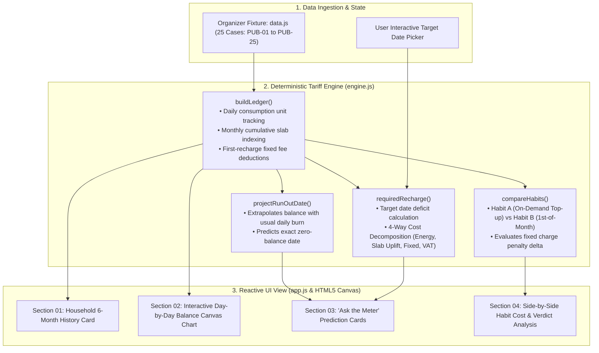

# ⚡ Prepaid Meter Recharge Advisor

<div align="center">


[](https://nahidzaman1996271-sketch.github.io/lsh26-t015_p10/)
[-FF4081?style=for-the-badge)]()
[]()
[]()

<br/>

**A deterministic household electricity ledger and smart recharge simulator built for the Bangladesh prepaid metering ecosystem.**  
*Reconstructs 6-month day-by-day balance ledgers, projects exact run-out dates under multi-slab tariffs, and compares recharge habits to eliminate unnecessary fixed fee overhead.*

[🚀 Launch Live Application](https://nahidzaman1996271-sketch.github.io/lsh26-t015_p10/) • [📋 Requirements Proof](#-requirements-compliance-matrix) • [📐 Tariff Mechanics](#-tariff-mechanics--engine) • [👥 Team](#-team--contributions) • [⚡ Local Setup](#-run-locally)

---

</div>

## 📌 Solution Summary

Prepaid electricity meters in Bangladesh calculate monthly tariffs using progressive consumption slabs and deduct fixed charges (demand charges and meter rent) exclusively upon the **first recharge of each calendar month**.

This application solves two crucial household questions:
1. **"When will our current balance run out at our typical daily consumption rate?"**
2. **"How much should we recharge today so our power stays on until our next salary date?"**

Additionally, the tool runs a side-by-side comparison between two typical user habits:
- **Habit A (Emergency Top-ups):** Recharging large amounts only when the low-balance alarm rings.
- **Habit B (Monthly Discipline):** Recharging on the 1st of every calendar month.

Over identical 3-month consumption traces, it proves mathematically which habit incurred lower cumulative fees and why.

---

## 🏛️ Architecture & System Design



---

## 📋 Requirements Compliance Matrix

| Requirement | Implementation Details | Verification Location | Status |
|:---|:---|:---|:---:|
| **R1 — 6+ Months Daily History** | Loads 6 full months of real daily meter readings and top-up events including heavy summer peaks, light winters, and end-of-month surges. | Section `01 — Six months on the meter`, switchable across 25 cases via header dropdown. | **Complete** |
| **R2 — Day-by-Day Ledger Rebuild** | Implements the complete tariff equation: cumulative monthly slab pricing, demand charge + meter rent on first recharge, 5% energy VAT, and balance tracking. | Section `02 — Balance, rebuilt day by day`; logic in `engine.js` (`buildLedger`). | **Complete** |
| **R3 — Run-Out & Target Date Calculator** | Computes projected run-out date and exact required recharge today with 4-way breakdown: Base Energy, Higher-Slab Uplift, Fixed Charges, and VAT. | Section `03 — Ask the meter`; logic in `engine.js` (`projectRunOutDate`, `requiredRecharge`). | **Complete** |
| **R4 — Recharge Habit Comparison** | Evaluates emergency low-balance top-ups vs. 1st-of-the-month top-ups over identical 3-month consumption traces, surfacing the exact cost gap. | Section `04 — Two recharge habits, same consumption`; logic in `engine.js` (`compareHabits`). | **Complete** |

---

## 📐 Tariff Mechanics & Engine Rules

### 1. Cumulative Monthly Slab Stepping
Each day's energy consumption is priced based on the total units consumed so far in that calendar month:
- **Slab 1 (0 – 75 units):** Baseline lifeline tariff
- **Slab 2 (76 – 200 units):** Intermediate standard rate
- **Slab 3 (201 – 300 units):** Progressive tier
- **Slab 4 (301 – 400+ units):** Upper consumption tier

### 2. Event-Driven Fixed Deductions
Meter rent and demand charges are deducted **only when a top-up occurs that is the first transaction of that calendar month**. If no top-up occurs in a month, the charge is carried forward until the next transaction.

### 3. Proportional Balance Offsetting
When projecting the required top-up to reach a target date, any existing positive meter balance is credited across the 4 payment components proportionally so that:
$$\text{Recharge Needed} = \text{Base Energy} + \text{Slab Uplift} + \text{Fixed Charges} + \text{VAT}$$

---

## ⚡ Run Locally

The application is completely static and client-side — no build steps, Node packages, or backend servers needed!

```bash
# Clone the repository
git clone https://github.com/nahidzaman1996271-sketch/lsh26-t015_p10.git
cd lsh26-t015_p10

# Option 1: Open index.html directly in your default browser
start index.html     # Windows
open index.html      # macOS

# Option 2: Serve using Python 3
python -m http.server 8000
# Navigate to http://localhost:8000
```

---

## 📁 Repository Structure

```plaintext
lsh26-t015_p10/
├── index.html                 # Semantic single-page application layout
├── styles.css                 # Clean typographic design (Fraunces & Space Mono)
├── engine.js                  # Pure mathematical tariff & projection engine
├── app.js                     # DOM bindings, canvas chart renderer, UI state
├── data.js                    # Embedded 25-case organizer test fixture
├── evaluation-manifest.json   # Hackathon automated scoring manifest
├── EVENT.md                   # Hackathon challenge specifications
├── LICENSES.md                # Font & asset licenses
└── README.md                  # Comprehensive solution documentation
```

---

## 👥 Team & Contributions

- **Event:** LofiStack Hackathon 2026
- **Problem Track:** P10 — Prepaid Meter Recharge Advisor
- **Team Name:** `Candy Crush` (Team ID: `LSH26-T015`)

| Member | GitHub | Role & Contribution |
|:---|:---|:---|
| **Nahid Ibn Zaman** | [@nahidzaman1996271-sketch](https://github.com/nahidzaman1996271-sketch) | Architecture, GitHub Pages deployment, release pipeline & logistics |
| **Farhan Ishraq Ifti** | `@252-35-648-ops` | Documentation, compliance specifications (`EVENT.md`, `LICENSES.md`) |
| **Tahmid Rashid Pranjol** | `@Tahmid-442` | QA, edge-case validation against all 25 fixture cases, regression verification |
| **Mahmuda Khanum** | `@252-35-537-del` | Core calculation engine (`engine.js`), ledger simulation algorithms |

---

<div align="center">
  <sub>Submitted by Team Candy Crush for LofiStack Hackathon 2026</sub>
</div>
